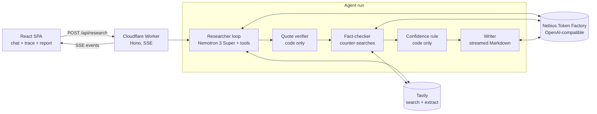

# Citation Needed

**Due diligence you can click through.** Name a company, vendor or startup; an AI agent researches the live web and returns a due diligence report where **every claim has a source, a verbatim quote and a confidence rating**. Click any `[n]` and the source opens scrolled to the highlighted quote. An adversarial fact-checker tries to break each claim before the report is written, and you watch every decision the agent makes, live.

- **Live demo:** _TBD — deployed Worker URL_
- **Demo video:** _TBD_


<sub>Screenshot from a local run against a mock Token Factory + Tavily upstream (fictional "Acme Bank" data).</sub>

Built for the Nebius Token Factory hackathon on top of the [Token Factory deep agent cookbook](cookbook/deep-agent-example-1/) (Nemotron + Tavily), ported to TypeScript on Cloudflare Workers.

## What it adds beyond the cookbook

| Cookbook deep agent | Citation Needed |
|---|---|
| Report with a URL list at the end | Every sentence carries claim-level citations; each claim stores the **verbatim quote** that supports it |
| Citations are trusted as written | **Quote verifier (code, no LLM):** the quote must appear in the extracted page text (exact match, then a ≥ 90% fuzzy window); links use `#:~:text=` fragments so the browser highlights the quote |
| Single pass | **Adversarial fact-checker** runs counter-searches against the weakest claims and returns `supported` / `contested` / `unverified` |
| No confidence signal | **Deterministic confidence rule** (never decided by a model): High = verified + supported + (2 independent domains or a primary source); Medium = verified + supported, single secondary source; Low = everything else |
| Terminal output | **Live trace UI:** plan, every search/read decision with the model's own reason, claims as they are recorded, fact-check verdicts, then the streamed report |

## How it works



1. **Researcher (model-driven loop, ≤ 14 turns).** The model calls `plan_areas`, `web_search`, `read_page`, `record_claim` and `finish_research`. It decides what to search, which pages to read, which facts to record and when to stop; code only enforces budgets (8 searches, 6 page reads, 20 claims). Every search/read carries a `reason` that the UI shows as the decision log.
2. **Quote verifier.** `record_claim` immediately checks the quote against the page text (Markdown stripped, quotes/dashes/whitespace normalized). The tool result tells the model `verified: true/false`, so it can fix bad quotes with `fix_claim_id`.
3. **Fact-checker.** Sees all claims, runs up to 6 counter-searches (one per claim, in parallel) and submits a verdict, a note and optional corroborating or counter-evidence URLs per claim.
4. **Confidence.** Computed in code from quote verification, verdict, independent domains and primary-source detection (regulators and registers by domain, company filings flagged by the checker).
5. **Writer.** Writes the report only from the claims, citing `[c:ID]` markers; the server renumbers sources by first citation and turns markers into links. If the writer fails, a code-built report is returned instead, so a run always ends with a result or a readable error.

If a model writes tool calls as text instead of native tool calls, the loop falls back to parsing a JSON action (`{"action": ..., "args": ...}` or `<tool_call>` blocks).

## Stack

- **Nebius Token Factory** through the `openai` SDK (`https://api.tokenfactory.nebius.com/v1`). Every role uses **`nvidia/nemotron-3-super-120b-a12b`** by default: a 120B hybrid MoE built for multi-agent tool use and long-context reasoning. Roles are configurable separately (`NEBIUS_MODEL_RESEARCH` / `CHECK` / `WRITE`), for example `reflection/beam` as the fact-checker for a second opinion, or `nvidia/NVIDIA-Nemotron-3-Nano-30B-A3B` as a cheap writer.
- **Tavily** `/search` (advanced, top 5) and `/extract` for page text.
- **Cloudflare Workers + Hono** for the API and SSE; the same Worker serves the SPA via static assets. A native rate-limit binding allows 5 runs per minute per IP.
- **React + Vite + Tailwind**; `react-markdown` + `remark-gfm` render the report, citations and badges.

## Run locally

Prerequisites: Node 22+ and pnpm (`corepack enable pnpm`), plus API keys for [Nebius Token Factory](https://tokenfactory.nebius.com) and [Tavily](https://tavily.com).

```bash
git clone https://github.com/Levanidd/Citation-Needed.git && cd Citation-Needed
cp .dev.vars.example apps/worker/.dev.vars   # then put your two keys into it
pnpm i
pnpm dev                                     # builds the web app, starts wrangler dev
open http://localhost:8787
```

`GET /api/health` reports whether both keys are present. For frontend hot reload, keep `pnpm dev` running and start `pnpm dev:web` (http://localhost:5173, proxies `/api` to :8787).

Other scripts: `pnpm typecheck`, `pnpm test` (verifier, confidence rule, citation numbering, tool-call fallback).

## Deploy

```bash
cd apps/worker
pnpm exec wrangler login
pnpm exec wrangler secret put NEBIUS_API_KEY
pnpm exec wrangler secret put TAVILY_API_KEY
cd ../.. && pnpm run deploy      # `pnpm deploy` is a built-in pnpm command, so use `run`
```

CI (`.github/workflows/deploy.yml`) typechecks, tests and builds on every push to `main`, then deploys when the repository secrets `CLOUDFLARE_API_TOKEN` and `CLOUDFLARE_ACCOUNT_ID` are set.

### Configuration

| Variable | Default | Purpose |
|---|---|---|
| `NEBIUS_BASE_URL` | `https://api.tokenfactory.nebius.com/v1` | Token Factory endpoint |
| `NEBIUS_MODEL_RESEARCH` / `_CHECK` / `_WRITE` | `nvidia/nemotron-3-super-120b-a12b` | Model per role |
| `NEBIUS_BASE_URL_RESEARCH` / `_CHECK` / `_WRITE` | empty (use `NEBIUS_BASE_URL`) | Per-role endpoint, for models served from other regions (e.g. `https://api.tokenfactory.us-central1.nebius.com/v1`) |
| `NEBIUS_EXTRA_BODY` | empty | JSON merged into every completion request, e.g. `{"chat_template_kwargs":{"enable_thinking":false}}` for lower latency |
| `TAVILY_BASE_URL` | `https://api.tavily.com` | Tavily endpoint |

## Limits and next steps

- A run is capped at 46 external calls (searches, page extracts, model calls) to stay under the Workers free plan's 50-subrequest limit, and at 150 seconds overall. Most of the time is spent waiting on the network, but quote matching on long pages can exceed the free plan's 10 ms CPU limit, so the Workers Paid plan is recommended.
- Runs are stateless: there is no history, auth or PDF export (Markdown export is built in).
- Text fragments need a Chromium-based browser or Safari 16.1+, and do not work inside PDFs.
- Next: per-area parallel sub-researchers, persisted runs (D1), a source-quality score per domain, and a "re-check this claim" button.

## Credits

- Starting point: the [Nebius Token Factory cookbook](https://github.com/nebius/token-factory-cookbook/tree/main/agents/langchain/deep-agent-example-1) deep research agent (MIT), copied into [`cookbook/deep-agent-example-1`](cookbook/deep-agent-example-1/).
- Search and extraction: [Tavily](https://tavily.com). Models: NVIDIA Nemotron via [Nebius Token Factory](https://tokenfactory.nebius.com).
