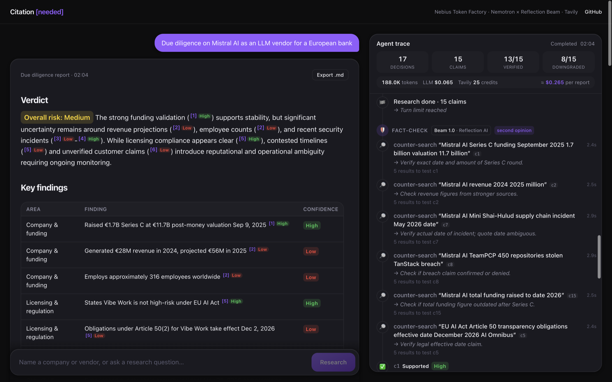
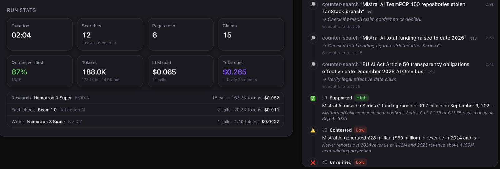
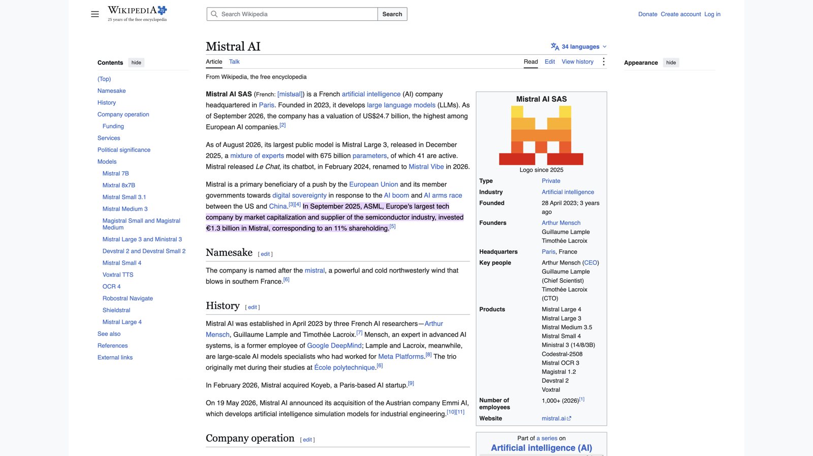
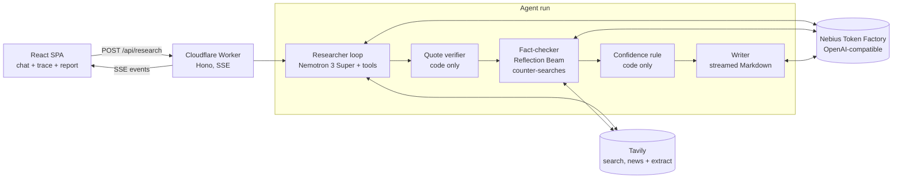

# Citation Needed

**Due diligence you can click through.** Name a company, vendor or startup; an AI agent researches the live web and returns a due diligence report where **every claim has a source, a verbatim quote and a confidence rating**. Click any `[n]` and the source opens scrolled to the highlighted quote. An adversarial fact-checker **from a different AI lab** (Reflection Beam checks what NVIDIA Nemotron found) tries to break each claim, an **adverse media scan** searches the last 12 months of news for fines, lawsuits and breaches, and a live meter shows what the report cost in tokens and dollars. You watch every decision the agent makes, live.

- **Live demo:** https://citation-needed.kurdyukov-leo-ger.workers.dev (a run takes about 1–2 minutes; 5 runs per minute per IP)
- **Demo video:** _TBD_



Run stats with the cost of the report per model, next to the fact-checker's verdicts:



Clicking a citation opens the source scrolled to the highlighted quote:



Built for the Nebius Token Factory hackathon on top of the [Token Factory deep agent cookbook](cookbook/deep-agent-example-1/) (Nemotron + Tavily), ported to TypeScript on Cloudflare Workers.

## What it adds beyond the cookbook

| Cookbook deep agent | Citation Needed |
|---|---|
| Report with a URL list at the end | Every sentence carries claim-level citations; each claim stores the **verbatim quote** that supports it |
| Citations are trusted as written | **Quote verifier (code, no LLM):** the quote must appear in the extracted page text (exact match, then a ≥ 90% fuzzy window); links use `#:~:text=` fragments so the browser highlights the quote |
| Single pass, one model | **Cross-lab adversarial fact-checker:** NVIDIA Nemotron 3 Super collects the claims, Reflection Beam 1.0 (a different lab, so different blind spots) runs counter-searches against the weakest ones and returns `supported` / `contested` / `unverified` |
| General web search only | **Adverse media screening:** a `news_search` tool queries Tavily's news index for the last 12 months (fines, lawsuits, breaches, regulatory actions); the fact-checker flags negative events and the report gets a dated *Adverse media* section |
| No confidence signal | **Deterministic confidence rule** (never decided by a model): High = verified + supported + (2 independent domains or a primary source); Medium = verified + supported, single secondary source; Low = everything else |
| No cost visibility | **Live token and cost meter:** tokens per role from every Token Factory response, priced with the per-token prices from the Token Factory model list, plus Tavily credits; a typical report costs about $0.20–0.30 |
| Terminal output | **Live trace UI:** plan, every search/read decision with the model's own reason, claims as they are recorded, fact-check verdicts, then the streamed report |

## How it works



1. **Researcher (model-driven loop, ≤ 18 turns).** The model calls `plan_areas`, `web_search`, `news_search`, `read_page`, `record_claim` and `finish_research`. It decides what to search, which pages to read, which facts to record and when to stop; code only enforces budgets (8 web searches, 2 news searches, 6 page reads, 20 claims). Every search/read carries a `reason` that the UI shows as the decision log. Nemotron on Token Factory emits one tool call per turn, so `record_claim` takes a batch (`claims: [...]`) and records every fact from a page in a single turn.
2. **Adverse media scan.** `news_search` uses Tavily's `topic: "news"` with `time_range: "year"` and passes publication dates to the model. If the model tries to finish without running it, the first `finish_research` is refused once with a reminder.
3. **Quote verifier.** `record_claim` immediately checks each quote against the page text (Markdown stripped, quotes/dashes/whitespace normalized). The tool result tells the model `verified: true/false` per claim, so it can fix bad quotes with `fix_claim_id`.
4. **Fact-checker (Reflection Beam).** A model from a different lab than the researcher sees all claims, sends up to 6 counter-searches in one batched `web_search` call (run in parallel), then submits a verdict, a note, corroborating or counter-evidence URLs and an `adverse_event` flag for every claim. Missing verdicts are requested once more. Beam is a reasoning model that requires its `reasoning_content` to be sent back on follow-up turns, so the checker keeps it in the conversation.
5. **Confidence.** Computed in code from quote verification, verdict, independent domains and primary-source detection (regulators and registers by domain, company filings flagged by the checker).
6. **Writer.** Writes the report only from the claims, citing `[c:ID]` markers; the server renumbers sources by first citation and turns markers into links. The *Adverse media* section lists exactly the claims the fact-checker flagged as negative events. The writer runs with Nemotron's thinking disabled, so the report starts streaming in under a second. If the writer fails, a code-built report is returned instead, so a run always ends with a result or a readable error.
7. **Cost meter.** Every completion's `usage` (including the streamed writer, via `stream_options.include_usage`) is added up per role and priced with the per-token prices from `GET /v1/models?verbose=true` (fetched once per isolate); Tavily calls send `include_usage: true` and report credits, priced at the pay-as-you-go $0.008 per credit. A `usage` SSE event after every call drives the live meter in the trace.

If a model writes tool calls as text instead of native tool calls, the loop falls back to parsing a JSON action (`{"action": ..., "args": ...}` or `<tool_call>` blocks).

## Stack

- **Nebius Token Factory** through the `openai` SDK (`https://api.tokenfactory.nebius.com/v1`):
  - Researcher and writer: **`nvidia/nemotron-3-super-120b-a12b`**, a 120B hybrid MoE built for multi-agent tool use and long-context reasoning.
  - Fact-checker: **`reflection/beam`** (Reflection Beam 1.0), a model from a different lab, so the checker does not share the researcher's blind spots.
  - Roles are configurable separately (`NEBIUS_MODEL_RESEARCH` / `CHECK` / `WRITE`), for example `nvidia/NVIDIA-Nemotron-3-Nano-30B-A3B` as a cheap writer.
- **Tavily** `/search` (advanced, top 5; `topic: "news"` for the adverse media scan) and `/extract` for page text.
- **Cloudflare Workers + Hono** for the API and SSE; the same Worker serves the SPA via static assets. A native rate-limit binding allows 5 runs per minute per IP.
- **React + Vite + Tailwind**; `react-markdown` + `remark-gfm` render the report, citations and badges.

## Run locally

Prerequisites: Node 22+ and pnpm (`corepack enable pnpm`), plus API keys for [Nebius Token Factory](https://tokenfactory.nebius.com) and [Tavily](https://tavily.com).

```bash
git clone https://github.com/Levanidd/Citation-Needed.git && cd Citation-Needed
cp .dev.vars.example apps/worker/.dev.vars   # then put your two keys into it
pnpm i
pnpm dev                                     # builds the web app, starts wrangler dev
open http://localhost:8787
```

`GET /api/health` reports whether both keys are present. For frontend hot reload, keep `pnpm dev` running and start `pnpm dev:web` (http://localhost:5173, proxies `/api` to :8787).

Other scripts: `pnpm typecheck`, `pnpm test` (verifier, confidence rule, citation numbering, tool-call fallback).

## Deploy

First deploy (the Worker does not exist yet, so the two required secrets are uploaded from `apps/worker/.dev.vars`):

```bash
pnpm build                                            # builds the SPA into apps/web/dist
cd apps/worker
pnpm exec wrangler login
pnpm exec wrangler deploy --secrets-file .dev.vars
```

Later deploys keep the secrets: `pnpm run deploy` from the repo root (`pnpm deploy` is a built-in pnpm command, so use `run`). Rotate a key with `pnpm exec wrangler secret put NEBIUS_API_KEY` in `apps/worker`.

CI (`.github/workflows/deploy.yml`) typechecks, tests and builds on every push to `main`, then deploys when the repository secrets `CLOUDFLARE_API_TOKEN` and `CLOUDFLARE_ACCOUNT_ID` are set.

### Configuration

| Variable | Default | Purpose |
|---|---|---|
| `NEBIUS_BASE_URL` | `https://api.tokenfactory.nebius.com/v1` | Token Factory endpoint |
| `NEBIUS_MODEL_RESEARCH` / `_WRITE` | `nvidia/nemotron-3-super-120b-a12b` | Researcher and writer models |
| `NEBIUS_MODEL_CHECK` | `reflection/beam` | Fact-checker model |
| `NEBIUS_BASE_URL_RESEARCH` / `_CHECK` / `_WRITE` | empty (use `NEBIUS_BASE_URL`) | Per-role endpoint, for models served from other regions (e.g. `https://api.tokenfactory.us-central1.nebius.com/v1`) |
| `NEBIUS_EXTRA_BODY` | empty | JSON merged into every completion request (overrides the writer's default `{"chat_template_kwargs":{"enable_thinking":false}}`), e.g. the same value to disable thinking for all roles |
| `TAVILY_BASE_URL` | `https://api.tavily.com` | Tavily endpoint |

## Limits and next steps

- A run is capped at 46 external calls (searches, page extracts, model calls) to stay under the Workers free plan's 50-subrequest limit, and at 150 seconds overall. Most of the time is spent waiting on the network, but quote matching on long pages can exceed the free plan's 10 ms CPU limit, so the Workers Paid plan is recommended.
- Runs are stateless: there is no history, auth or PDF export (Markdown export is built in).
- Text fragments need a Chromium-based browser or Safari 16.1+, and do not work inside PDFs.
- Next: per-area parallel sub-researchers, persisted runs (D1), a source-quality score per domain, and a "re-check this claim" button.

## Credits

- Starting point: the [Nebius Token Factory cookbook](https://github.com/nebius/token-factory-cookbook/tree/main/agents/langchain/deep-agent-example-1) deep research agent (MIT), copied into [`cookbook/deep-agent-example-1`](cookbook/deep-agent-example-1/).
- Search and extraction: [Tavily](https://tavily.com). Models: NVIDIA Nemotron via [Nebius Token Factory](https://tokenfactory.nebius.com).
